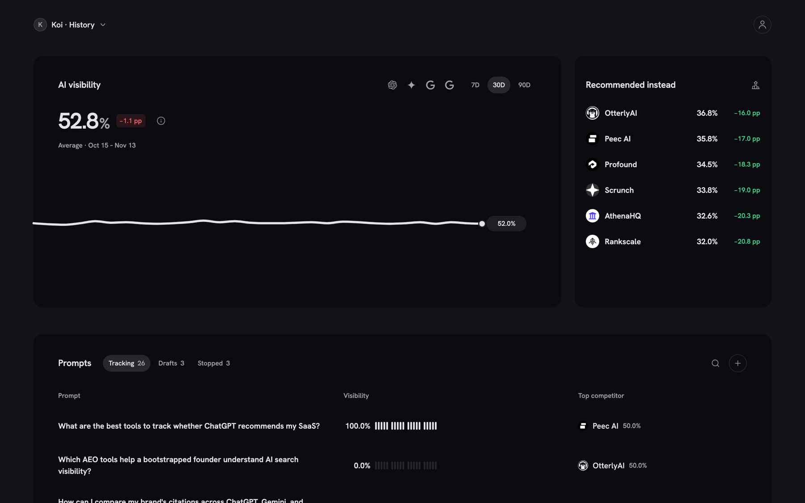

<div align="center">
  <p></p>
  <h1>Koi</h1>
  <p>See whether AI answer engines recommend your product, and who they recommend instead.</p>

  <p>
    <a href="https://github.com/koihq/koi/releases"></a>
    <a href="https://github.com/koihq/koi/actions/workflows/ci.yml"></a>
    <a href="LICENSE"></a>
  </p>
</div>

Koi is an open-source alternative to Profound and Peec AI. It asks ChatGPT, Gemini, Google AI
Mode and Google AI Overviews the questions your buyers ask, every day. For each answer it records
whether your product is cited, mentioned or missing, which competitors appear, and which sources
the engine used. Then it writes a Markdown brief that your coding agent can act on in your repo.

[Self-host](#self-host) · [Connect your agent](#connect-your-agent) ·
[Configuration](docs/configuration.md) · [Koi Cloud](https://getkoi.co)

<div align="center">
  
  <p><sub>Demo data: the answers, competitors and numbers are simulated.</sub></p>
</div>

## Features

- Four engines: ChatGPT, Gemini, Google AI Mode and Google AI Overviews.
- Per-prompt results: cited, mentioned or missed, with the full answer and its sources.
- Competitors: who each engine names instead of you, and the URLs it cites for them.
- Daily tracking: one check a day, with 7, 30 and 90-day trends.
- Agent first: an MCP server and two agent skills, so Claude Code, Codex or Cursor can set up
  Koi and turn the results into changes.
- AI drafting: suggests prompts and competitors from your website. You confirm them before Koi
  spends anything.
- Self-hosted: one command, your own Cloro key, MIT license.

## Quick start

### Koi Cloud

Sign up at [getkoi.co](https://getkoi.co). Nothing to install, and engine costs are included.

### Self-host

You need Docker with Docker Compose v2.

```sh
curl -fsSL https://raw.githubusercontent.com/koihq/koi/main/install.sh | sh
```

The installer creates `./koi` with `docker-compose.yml` and `.env`, generates a database
password, and starts Koi on `http://localhost:8080`. The first account you create owns the
instance. [Read the installer](install.sh) or [install manually](docs/self-hosting.md#install-manually).

Live answers come from [Cloro](https://cloro.dev). Add your key to `koi/.env`, then apply it:

```sh
cd koi
echo 'KOI_CLORO_API_KEY=your-key' >> .env
docker compose up -d
```

The [self-hosting guide](docs/self-hosting.md) covers HTTPS, upgrades and backups.

## Connect your agent

Koi serves an MCP endpoint at `/mcp`. Your agent signs in with OAuth and can do everything the UI
does. For Claude Code:

```sh
claude mcp add --transport http koi https://<your-host>/mcp
npx skills add koihq/koi --skill koi-setup --skill koi-brief
```

Run `/mcp` to authorize, then ask your agent to set up Koi for the current project.
[docs/mcp.md](docs/mcp.md) covers Codex, Cursor, ChatGPT and Claude on the web.

## Configuration

Only `KOI_CLORO_API_KEY` is needed for live data. Every other service is optional:

| Service | Adds | Without it |
| --- | --- | --- |
| [OpenRouter](https://openrouter.ai) | Drafts prompts and competitors; checks that a mention is about your product | You write them yourself |
| [Logo.dev](https://logo.dev) | Company search and logos | Initial-letter icons |
| [Resend](https://resend.com) | Welcome and password reset emails | Reset passwords from the server |

See [configuration](docs/configuration.md) for every variable and
[troubleshooting](docs/troubleshooting.md) if something does not work.

## Contributing

See [CONTRIBUTING.md](CONTRIBUTING.md) for local development, demo data and checks. Open an issue
before starting a larger change. The [architecture guide](docs/architecture.md) describes the Go
API, workers and React UI.

## Security

[Report a vulnerability privately](https://github.com/koihq/koi/security/advisories/new). Read
[SECURITY.md](SECURITY.md) for the process.

## License

[MIT](LICENSE)
